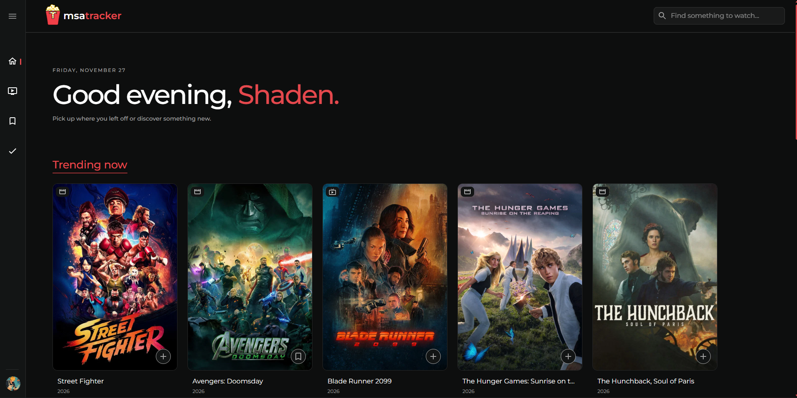
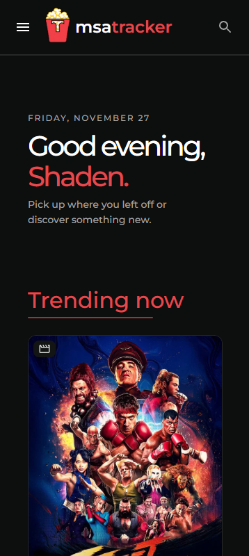
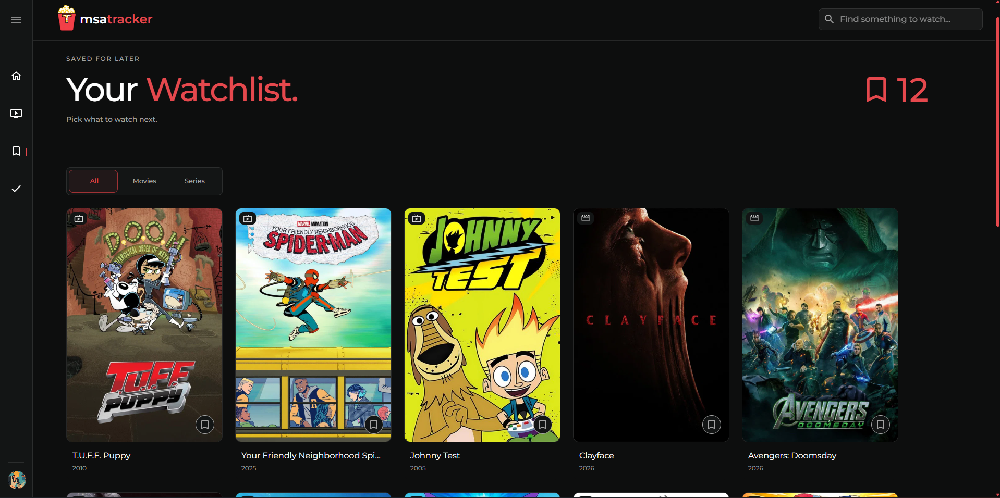
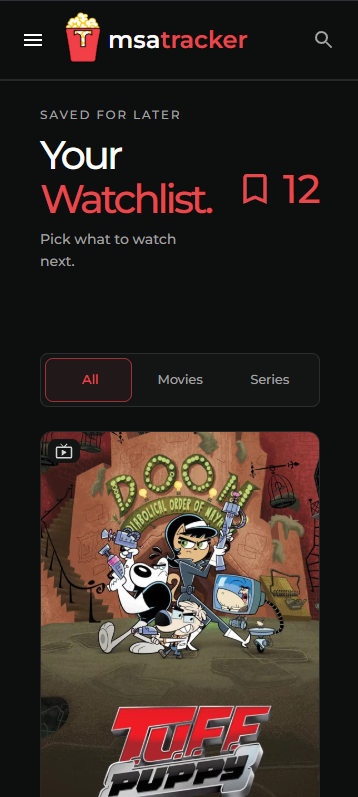
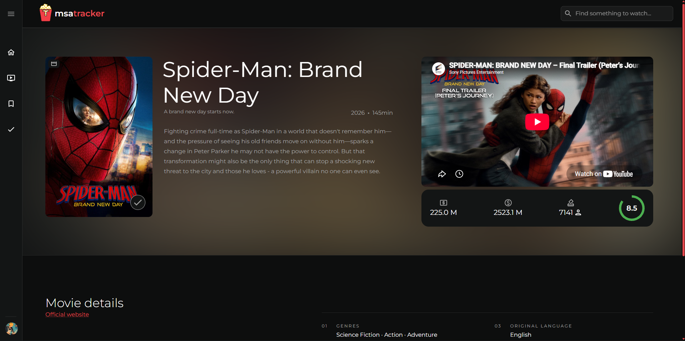
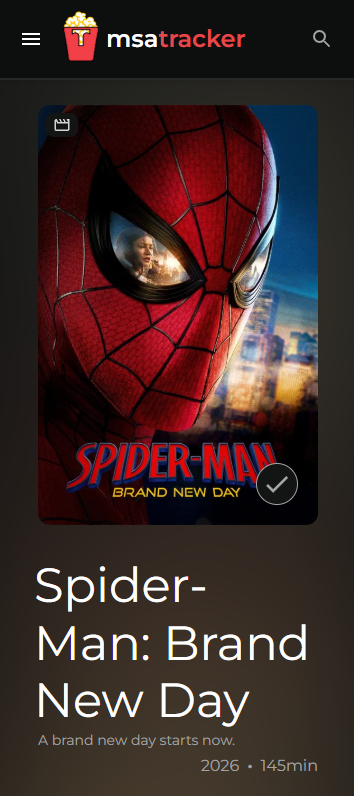
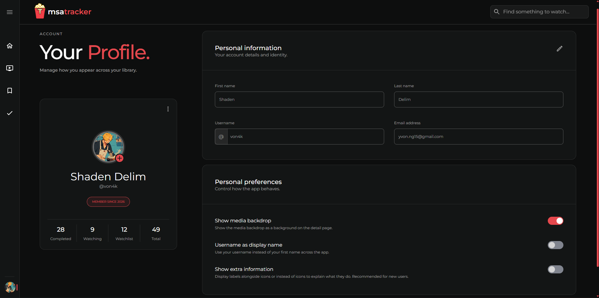
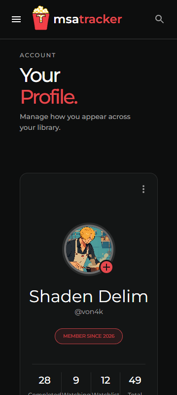

<div align="center">

# MSATracker

**Your personal tracker for movies, TV series and anime.**
Discover what to watch next, track what you're watching now, and remember everything you've finished.

[**Live App**](https://msatracker.com) - [**Features**](#features) -
[**Tech Stack**](#tech-stack) - [**Getting Started**](#getting-started)


|       Page        |                                              Desktop                                              |                                             Mobile                                              |
|:-----------------:|:-------------------------------------------------------------------------------------------------:|:-----------------------------------------------------------------------------------------------:|
|     **Home**      |                   |                   |
|   **Watchlist**   |         |         |
| **Media Details** |  |  |
|    **Profile**    |             |             |

</div>

---

## About

msatracker is a personal hobby project built to solve a simple problem: keeping track of the movies, TV series and anime
I want to watch.

What started as a fix for my own watchlist chaos became a chance to explore web development, experiment with modern
technologies and turn an idea into a fully functional application.

## Features

| Feature                         | Description                                        |
|---------------------------------|----------------------------------------------------|
| **Discover Media**              | Search for movies and TV series powered by TMDB.   |
| **Watchlist**                   | Save the movies and series you want to watch.      |
| **Currently Watching**          | Manage everything you're in the middle of.         |
| **Completed**                   | Keep a record of what you've finished.             |
| **Media Details**               | Descriptions, ratings, release dates and more.     |
| **Profile and Personalization** | Manage your account and tweak display preferences. |

## Tech Stack


## Getting Started

### Prerequisites

- [Node.js](https://nodejs.org/) and npm
- A [Supabase](https://supabase.com/) project
- A [TMDB](https://www.themoviedb.org/) API account and access token

### Installation

```bash
# 1. Clone the repository
git clone <repository-url>

# 2. Move into the project
cd msatracker

# 3. Install dependencies
npm install
```

Create a `.env` file in the project root:

```env
VITE_TMDB_BEARER_TOKEN=your_tmdb_bearer_token
VITE_SUPABASE_URL=your_supabase_project_url
VITE_SUPABASE_PUBLISHABLE_KEY=your_supabase_publishable_key
```

Start the development server and open the local URL Vite prints:

```bash
npm run dev
```

## Available Scripts

| Command           | Description                           |
|-------------------|---------------------------------------|
| `npm run dev`     | Starts the development server         |
| `npm run build`   | Builds the app for production         |
| `npm run lint`    | Runs the linter                       |
| `npm run preview` | Previews the production build locally |

## API and Attribution

msatracker uses the [TMDB API](https://developer.themoviedb.org/) to retrieve movie and TV series information.
This product uses the TMDB API but is not endorsed or certified by TMDB.

## Disclaimer

msatracker is a media tracking and organization application. It does not host, distribute or stream movies, television
series or anime.

## License and Usage Terms

*Copyright © 2026 MSATracker. All rights reserved.*

This repository is made public for **viewing and reference purposes only**.

- **Allowed:** Viewing and reading the source code.
- **Not allowed:** Copying, modifying, distributing, or using this code (in whole or in part) in personal, academic, or
  commercial projects without explicit written permission.

For licensing inquiries, contact **ng.shaden@gmail.com**.